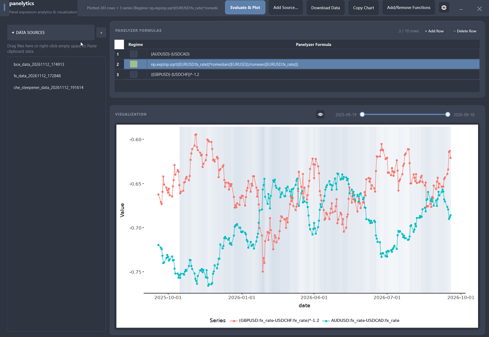

# panelytics
Using panelyzer visualize data from files, clipboards, databases, etc. jointly with python library functions (including user functions)

## Running the GUI

Ensure the environment is synced, then launch the desktop application with `uv`:

```bash
uv sync
uv run python panelytics.py
```

Settings, plot preferences, configured data sources, formulas, and user function imports are persisted automatically to `~/panelytics.json`.




